


<a href="https://skavyoy8.github.io/">
  <picture>
    <source media="(prefers-color-scheme: dark)" srcset="https://readme-typing-svg.demolab.com?font=JetBrains+Mono&weight=600&size=20&duration=2800&pause=900&color=3DFF9A&center=true&vCenter=true&width=640&height=44&lines=Salut%2C+moi+c%27est+Luke+alias+Skavyoy8;%C3%89l%C3%A8ve+en+Terminale+Bac+Pro+CIEL;Cybers%C3%A9curit%C3%A9+%C2%B7+R%C3%A9seaux+%C2%B7+Linux;Homelab+Proxmox+en+construction;Je+cherche+une+alternance+BTS+SIO+SISR+%282027%29">
    
  </picture>
</a>

  
  
  
  

## <samp>01 · whoami</samp>


> [!TIP]
> **Je cherche une alternance en BTS SIO option SISR pour la rentrée 2027.**
> Le plus simple pour me joindre : Discord **`skavyoy_`**, ou la page [contact de mon portfolio](https://skavyoy8.github.io/#contact).

## <samp>02 · compétences</samp>


## <samp>03 · homelab</samp>

<a href="https://skavyoy8.github.io/#homelab"></a>

Le rack interactif (vue éclatée, 360°) est sur <a href="https://skavyoy8.github.io/#homelab">mon portfolio</a>.

## <samp>04 · projets</samp>

  <a href="https://skavyoy8.github.io/"></a>
  <a href="https://skavyoy8.github.io/interview-lab/"></a>

  <a href="https://skavyoy8.github.io/maths-log-base-q/"></a>
  <a href="https://skavyoy8.github.io/sciences-piles-accus/"></a>

Et aussi : <a href="https://skavyoy8.github.io/maths-feuille-ds/">révision du DS (exponentielle et log décimal)</a> · <a href="https://github.com/Skavyoy8?tab=repositories">tous mes dépôts →</a>

## <samp>05 · parcours</samp>

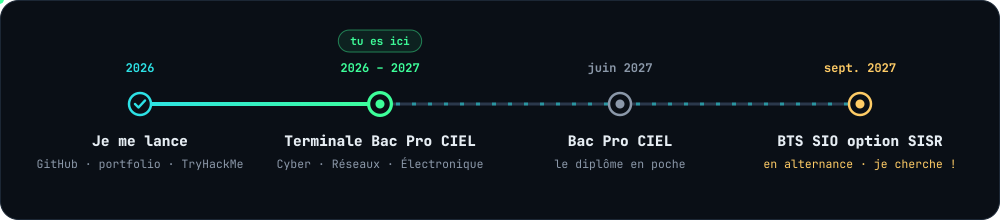

## <samp>06 · activité</samp>


<picture>
  <source media="(prefers-color-scheme: dark)" srcset="https://raw.githubusercontent.com/Skavyoy8/Skavyoy8/output/snake-dark.svg">
  
</picture>

  


  

